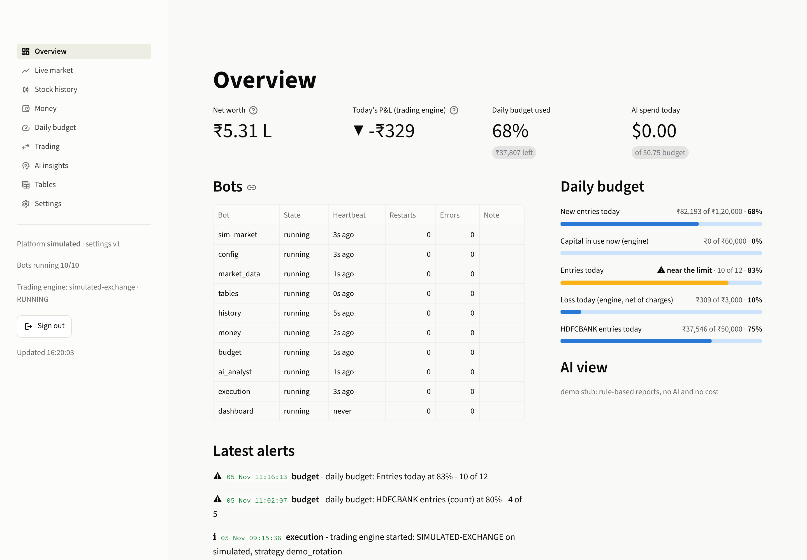
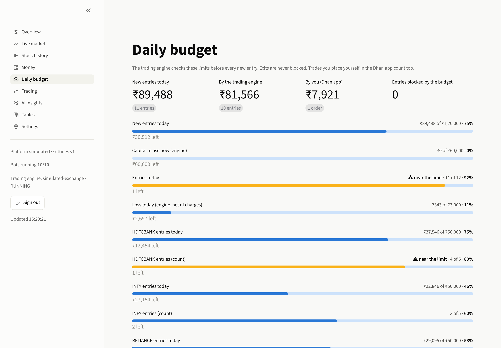
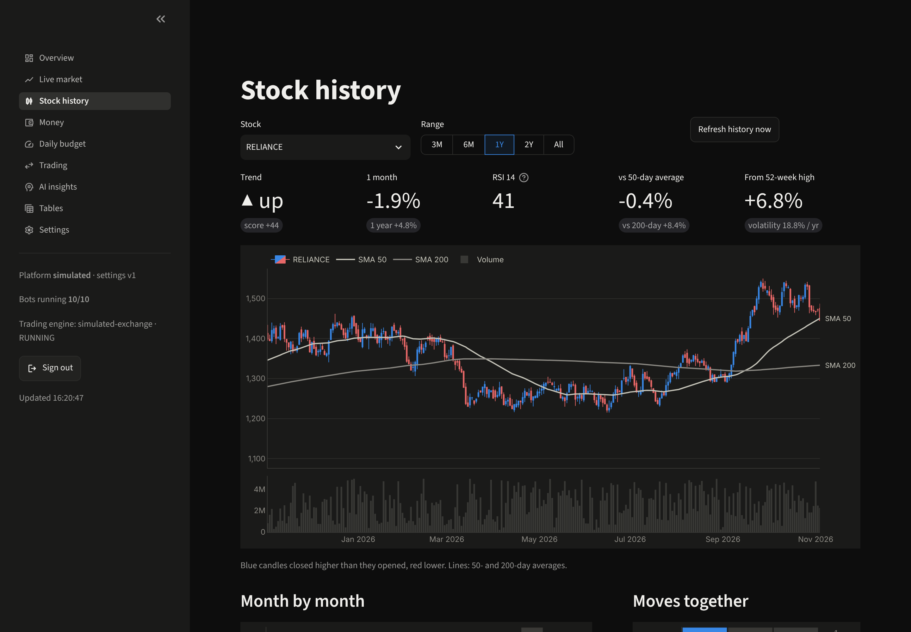
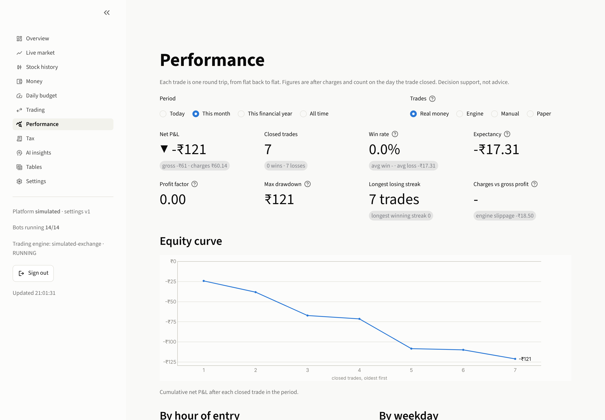
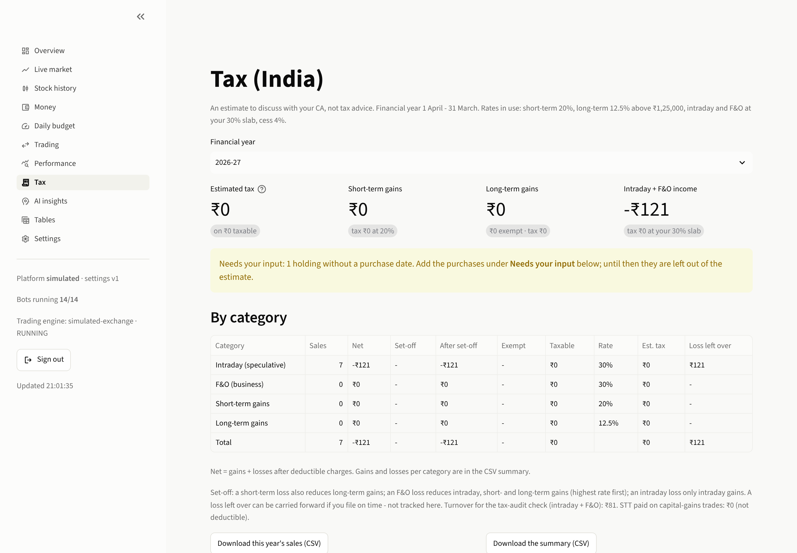

# trading-bots

A team of small bots that work together around your Dhan account. Each bot does one job:
- fetches live market data;
- keeps your settings and the trading platform;
- turns everything into tidy tables;
- analyses each stock's history and trend;
- tracks where your money goes;
- enforces a daily budget on every trade;
- runs your trading strategy;
- asks Claude for a plain-language read of it all;
- keeps a performance journal of every trade;
- estimates your Indian tax and prepares statements for your CA;
- sends alerts and a daily summary to Telegram and email;
- backs everything up every night.

A password-protected web dashboard shows the team's work and lets you control it.



> **Safety first.**
> - The AI's output is advice only. No bot ever turns it into an order.
> - Trading is off until you switch it on (`execution.enabled`). It runs in **paper** mode until both
>   `execution.live = true` **and** `mode = "live"` in your dhan_bot config say otherwise.
> - Every new entry passes your daily budget. Exits are never blocked.
> - Try everything first with `bots demo`, a whole simulated trading day with no account and no real money.

## The team

| Bot | Its one job | Keeps | Tells the others |
|---|---|---|---|
| **config** | Your settings and the trading platform. It is the only bot that logs in to Dhan | `config/settings.toml`, every version (with rollback), the Dhan token | `config.changed`, `auth.token` |
| **market_data** | Live prices from the selected platform | the feed connection | quotes (about 4 a second), 1-minute candles built from every tick, account snapshots |
| **tables** | Turns the stream into neat, typed tables | `data/tables/` (Parquet, read with DuckDB / Polars) | `tables.updated` |
| **history** | Each stock's history and trend | daily candles, metrics, seasonality, correlations | `history.updated` |
| **money** | Where the money is and where it goes: by platform, stock and month; charges; cash flows; expenses | `money_*` tables, your expense entries | `money.updated` |
| **budget** | Today's money limits and what has been used, including trades you place yourself in the Dhan app | budget history, alerts | `budget.policy`, `budget.usage` |
| **execution** | Runs your [dhan_bot](https://github.com/MSatishssj3/Amaha_QA_Automation/tree/cl/epic-cray-ipx99n/dhan_bot) strategy with the budget guard attached | the trading engine | orders, fills, P&L, state |
| **ai_analyst** | Claude reads the tables and writes reports | reports, its own cost log | `ai.report`, `ai.cost` |
| **journal** | How your trading is really going: every round trip, win rate, expectancy, drawdown, charges and slippage, with your own tags and notes | `perf_*` tables, `journal.db` (your notes) | `journal.updated` |
| **tax** | Estimated Indian tax per financial year (intraday, F&O, short- and long-term gains) and statements for your CA | `tax_*` tables, `tax.db` (purchases you add) | - |
| **notifier** | Alerts and a daily summary on Telegram and email; commands from your Telegram chat | - | - |
| **backup** | A verified archive of `config/` and `data/` every night, optional cloud copy | `backups/` | `backup:status` |
| **supervisor** | Starts every bot in its own process and restarts any that crash or hang | - | status |
| **dashboard** | What you look at and click | - | commands to the bots |

```
 Dhan ── feed / REST ──► market_data ── quotes, candles, account ──► tables ── tables.updated ──┐
   ▲                         ▲                                         │ (Parquet + DuckDB)     │
   │      config ── settings, platform, Dhan token ──► every bot       ▼                        ▼
   │                                          history · money · budget ───────────────► ai_analyst (Claude)
   │                                                        │ limits (budget.policy)          │ reports
   └── orders ── execution (dhan_bot engine + BudgetGuard) ◄┘                                 ▼
                     │ orders, fills, P&L ──► tables, money, budget              dashboard (login)
           supervisor: one process per bot, restarts, health
           journal and tax (read the tables) · notifier (alerts -> Telegram, email) · backup (nightly archive)
```

The bots talk only through a **message bus**: events, request/reply commands and a small key-value
store. The default bus is **SQLite**, which needs no extra software and works on Windows too.
**Redis** is optional for bigger setups. Data that other bots or the AI read lives in **tables**,
each with one owner bot. See [docs/tables.md](docs/tables.md) for every table and column, and
[docs/messages.md](docs/messages.md) for every event, key and command.

## Try it now: the demo

```bash
pip install -e .                 # Python 3.11+; installs dhan_bot's engine from its repository
bots demo                        # prints the dashboard address and a one-time password
```

`bots demo` runs the whole team on a built-in **simulated exchange**. It plays one trading day at 60×
speed, so a session takes about six minutes:
- A demo strategy (not a trading idea) buys and sells so you can watch orders, fills, charges, the
  money tables and the daily budget fill up, until the budget starts blocking entries.
- One "manual" purchase shows that trades you make yourself count against the budget too.
- AI reports come from simple rules (clearly marked) unless you run `bots demo --ai` with an
  `ANTHROPIC_API_KEY` in `.env`. That makes real Claude calls, capped at $0.75 for the demo.

## Use it with your Dhan account

```bash
bots init              # config/settings.toml, config/dhanbot.toml, config/holidays.txt, .env
bots set-password      # dashboard password (stored as a scrypt hash, never in clear)
```

1. In **`.env`**:
   - `DHAN_CLIENT_ID`;
   - either a daily `DHAN_ACCESS_TOKEN` (you can also paste it on the dashboard), or `DHAN_PIN` and
     `DHAN_TOTP_SECRET` for automatic login (`platform.dhan_auth = "totp"`);
   - optionally `ANTHROPIC_API_KEY` for the AI analyst.
2. In **`config/settings.toml`**:
   - `platform.name = "dhan"`;
   - your watchlist;
   - your daily budget.

   Every setting is explained in [config/settings.example.toml](config/settings.example.toml).
3. In **`config/holidays.txt`**: this year's NSE holidays (from nseindia.com). Only fixed-date
   holidays are pre-filled, because moving dates could not be verified.
4. `bots check`: read-only checks of the settings, bus, Dhan token and data plan, AI key and
   dashboard password.
5. `bots run --all`: the whole team plus the dashboard at http://127.0.0.1:8501.

Live prices need Dhan's Data API plan. Real orders need your server's static IP registered with Dhan.
To run your strategy inside the team, edit `config/dhanbot.toml` (instruments, strategy, risk limits)
and set `execution.enabled = true`.

## The daily budget gatekeeper

You set today's limits; the trading engine checks them **before every new entry**:

| Limit | Meaning |
|---|---|
| `daily_capital_limit_inr` | total value of new entries today: the engine's and yours |
| `max_capital_in_use_inr` | open positions plus entries still working, at any moment |
| `per_stock_daily_limit_inr` (+ `per_stock_overrides`) | per stock per day |
| `per_platform_daily_limit_inr` | per platform per day |
| `max_trades_per_day`, `max_trades_per_stock` | entry counts |
| `max_daily_loss_inr` | reaching it **halts** the engine for the day (flatten, no new entries) |

How the checks work:
- **Fast and in-process.** The check runs inside the trading engine as an in-memory lookup that
  takes microseconds, with no network round trip per order. The budget bot pushes the limits ahead
  of time, and changes apply within seconds without a restart.
- **No double-spend.** An accepted entry reserves its value; fills convert the reservation into
  usage, and a cancel or reject releases it. Two entries at the same moment can never jointly exceed
  a limit.
- **Your own trades count.** BUY trades you place in the Dhan app are read from the broker's trade
  book and reduce what the engine may still spend today (`count_manual_trades`). Manual sells are
  treated as exits.
- **Exits are never blocked.** Closing a position is always allowed.
- **Fail-closed.** If the budget bot has not published a fresh policy, new entries are blocked
  (`fail_mode = "closed"`). A crashed budget bot can't silently remove your limits.
- **Alerts.** You get an alert at 80 % and 100 % of each limit (`alert_at_pct`), when an entry is
  blocked, and in an end-of-day summary.

The budget can only make trading **stricter**: dhan_bot's own risk limits still apply on top.



## The trading engine (execution bot)

The execution bot hosts the same `dhan_bot` engine you already have: your strategy, its risk rules,
order manager, super orders and square-off. It adds:
- the budget guard, attached before the strategy can place its first order;
- forwarding of orders, fills, P&L and state to the team, from a queue so the order path is never
  slowed.

From the dashboard you can **pause**, **resume**, **flatten** and **kill for today**.

- **Paper by default.** Real orders need `execution.live = true` **and** `mode = "live"` in
  `config/dhanbot.toml`.
- **One engine per account.** Stop dhan_bot's own service when you use this one
  (`sudo systemctl disable --now dhanbot`). Two engines on one account would double-trade. If both
  point at the same data folder, the second refuses to start.
- **Token.** The config bot is the only one that logs in or renews the Dhan token. It hands the
  token to the engine, so the two never invalidate each other.

## The AI analyst (Claude)

At 08:45 (pre-open), 12:30 and 15:45 on trading days, and whenever you press **Run analysis now**,
the analyst sends Claude a compact data packet built from the tables. Raw ticks never go in. The
packet holds each stock's returns, averages, RSI, MACD, ADX, volatility, 52-week position, volume
and trend label, plus your positions, P&L, allocation, charges and today's budget use. Claude
returns a structured report: per stock trend, outlook, key levels, observations, risks, confidence
and a watch suggestion (watch / consider entry / consider exit / hold / avoid), plus a portfolio
section and caveats. **It is decision support, not financial advice, and nothing reads it but you.**

- **Model:** `claude-opus-5-5`, effort `high`, adaptive thinking.
- **Format:** the output is enforced with structured outputs, so every report is complete and
  well-formed.
- **Refusal fallbacks are on** (`ai.refusal_fallbacks = true`). If Claude declines a request, the
  API re-runs it on the model Anthropic recommends for that case, in the same call. Switch it off
  in settings if you prefer.
- **Cost control:**
  - the fixed instructions are prompt-cached;
  - tokens are counted before sending;
  - a **daily dollar cap** (`ai.daily_usd_budget`, default $1) skips runs that would exceed it;
  - every call's tokens and cost are logged (AI insights page, `ai_costs` table) and booked as an
    expense by the money bot.
- **Rough cost estimate, not measured:** about $0.10-0.40 per run for 20 stocks. Your own numbers
  appear on the AI insights page after a few runs.
- **Nightly deep dives** (`ai.nightly_batch`, off by default): one request per stock through the
  Message Batches API at half price.
- **No key, no AI.** Without `ANTHROPIC_API_KEY` the analyst stays off and the dashboard says how to
  enable it. `bots ai test` makes one tiny real call to check your key.

## History and trends

For every watchlist stock (and anything you hold), the history bot keeps daily candles (2 years by
default) and computes:
- returns over 1 day to 1 year, year to date, and CAGR;
- volatility, maximum drawdown and Sharpe;
- 20/50/200-day averages and their crosses;
- RSI 14, MACD, ATR % and ADX;
- 52-week high and low;
- volume against its 20-day average;
- beta and relative strength against NIFTY;
- swing support and resistance;
- month-by-month returns and correlations between stocks.

The **trend label** (strong up / up / sideways / down / strong down) is a transparent rule: a score
from -100 to +100 averages four signals:
- the close against the 50-day average;
- the 50-day against the 200-day average;
- the slope of the 50-day average;
- 3-month momentum.

"Strong" also needs ADX ≥ 25.



## Money

The money bot works from your trades (with Dhan's per-trade brokerage, STT, exchange, SEBI, stamp
duty and GST), ledger, holdings, positions and funds. It keeps:
- where the money is, by platform and stock;
- realised and unrealised P&L by day, month and stock;
- charges by type, platform, stock and month, as a percentage of turnover;
- deposits and withdrawals;
- your other expenses: data plan, server, the AI's cost (added automatically) and anything you add
  on the dashboard;
- a summary: net worth, charges this month and year, and XIRR.

## Performance journal

The journal bot turns your trades into **round trips**, from flat back to flat: scaling in and out stays one trade,
and a reversal is split. It covers the engine's trades and the ones you place yourself, with the broker's actual
charges. Paper trades are kept in a separate book, so they never mix with real money. For engine trades it also
records **slippage** against the price the engine expected, and how each trade ended: target, stop-loss,
square-off and so on.

The Performance page shows, for any period and source:
- net P&L, win rate, expectancy, payoff, profit factor, max drawdown, streaks, and charges against gross profit;
- an equity curve;
- P&L by hour of entry, weekday and stock;
- tables of how trades ended, how long they were held, and your tags.

You can tag trades (`breakout`, `news`, `revenge` ...) and add notes in the journal table; tags get their own
breakdown. The AI analyst and the daily summary use these figures too.



## Tax (India)

The tax bot estimates the tax on your trades for each financial year (1 April to 31 March). It is **an estimate to
discuss with your CA, not tax advice**.
- **Categories.** Every sale is matched first in, first out to its purchase and counted as one of:
  - intraday equity: speculative income, including same-day delivery buys and sells, which are netted;
  - F&O and other derivatives: business income;
  - short-term capital gains (held up to 12 months);
  - long-term capital gains (held more than 12 months).
- **Rates.** Defaults are for tax year 2026-27: short-term 20%, long-term 12.5% above ₹1.25 lakh a year, intraday
  and F&O at your slab rate, 4% cess. The surcharge on capital gains is capped at 15%. Set your slab and surcharge
  in `[tax]`.
- **Rules applied.**
  - STT is not deductible from capital gains; for business income every charge counts.
  - Shares bought before 1 Feb 2018 can use their 31 Jan 2018 price (grandfathering).
  - Losses are set off within the year: a short-term loss against long-term gains; an F&O loss against
    intraday, short- and long-term gains, highest rate first; an intraday loss only against intraday gains.
- **Purchases are never guessed.** The bot fetches your broker trade history back to the previous financial year.
  A sale or holding older than that is listed under **Needs your input** on the Tax page, where you add its date
  and price.
- **Planning.** The page shows when each lot you hold turns long-term ("INFY: 12 days to go").
- **For your CA.** `bots tax report --fy 2026-27` (or the page's download buttons) gives every sale as CSV.
- **Not covered.** Losses carried in from earlier years, your other income, options that expired without a closing
  trade, and splits or bonus issues (add those as purchases).



## Notifications (Telegram and email)

The notifier sends WARNING and ERROR alerts to Telegram, plus a few chosen INFO ones: engine started, the day
report, the budget summary, AI reports. It also sends a daily summary at 15:50 on trading days: P&L, budget, closed
trades, money, AI headline and bot health.
- **Email** gets the daily summary and ERROR alerts.
- **Repeats** are sent at most once per 10 minutes. During quiet hours (22:00-07:00) only ERROR alerts go out.
- **Telegram commands** come from your chat only: `/status`, `/pnl`, `/positions`, `/budget`, `/report`, `/ai`,
  `/pause`, `/resume`, `/flatten` and `/kill`. The last two need `/confirm`.
- **Setup.**
  1. Create a bot with @BotFather and put `TELEGRAM_BOT_TOKEN` and `TELEGRAM_CHAT_ID` in `.env`.
  2. For email, add `SMTP_*` and `EMAIL_TO`.
  3. Press **Send a test message** in Settings -> Notifications, or run `bots notify test`.

## Backups

Every night at 23:45 the backup bot writes `backups/trading-bots-YYYYMMDD-HHMMSS.tar.gz`.
- **Contents:** your settings and every bot's data: tables, databases, reports, the engine's state.
- **Never included:** `.env`, the message bus, access tokens, and caches that are downloaded again.
- **Consistency:** databases are copied consistently even while in use.
- **Checked:** each archive is read back against its checksums before it is kept.
- **Retention:** the newest backup of each of the last 7 days, plus each of the last 4 weeks.
- **Off-machine copy:** set `backup.rclone_remote` (e.g. `gdrive:trading-bots`) with [rclone](https://rclone.org)
  installed.
- **A failure** is an ERROR alert on your phone.

**Restore:** stop the team, then run `bots restore backups/<archive>`. It refuses while any bot runs and checks every
checksum first. Your current `config/` and `data/` are moved aside (never deleted), and your current access token is
kept.

## Dashboard

The pages are Overview, Live market, Stock history, Money, Daily budget, Trading, Performance, Tax, AI insights,
Tables (browse any table, download CSV) and Settings. Settings covers the platform, watchlist, schedules, AI options,
notifications, backups, the Dhan token and version history with one-click rollback.
- **Access:** the dashboard listens on `127.0.0.1` and needs your password. On a server, reach it
  through an SSH tunnel.
- **Themes:** light and dark.
- **Changes:** every change goes through the bot that owns it, which validates it first.

## Command line

| Command | What it does |
|---|---|
| `bots init` | create the config files from templates |
| `bots set-password` | set the dashboard password |
| `bots check [--login]` | read-only checks (with `--login`, a TOTP login if no token is cached) |
| `bots demo [--speed 60] [--ai] [--notify] [--minutes N]` | the whole team on the simulated exchange |
| `bots run --all` | every bot + the dashboard, supervised (what the server runs) |
| `bots run <bot>` / `bots run dashboard` | one bot in the foreground |
| `bots status` | health of every bot |
| `bots tables list` / `show <t>` / `export <t> --out f.csv` | look at the tables |
| `bots ai test` | one tiny Claude call to check the key |
| `bots notify test` / `summary` | a test message on Telegram and email / today's summary now |
| `bots tax report [--fy 2026-27] [--out f.csv]` | the year's estimated tax, and every sale as CSV for your CA |
| `bots backup now` / `list` / `verify <archive>` | back up now, list the archives, check one |
| `bots restore <archive> [--yes]` | put a backup back (the team must be stopped) |
| `bots config get [key]` / `set a.b=value ...` / `history` / `rollback N` | settings |

All commands take `--dir <project folder>` (default: the current folder).

## Deploying

- **Server (recommended):** a small Mumbai VPS with a static IP, the systemd unit in
  [deploy/](deploy/), and the step-by-step guide in
  [deploy/vps_setup.md](deploy/vps_setup.md).
- **Docker:** `docker compose up -d --build` runs the team with a Redis bus. The dashboard is
  published on 127.0.0.1:8501.
- **Windows (your PC):** `pip install -e .`, then `bots run --all`. The SQLite bus needs nothing
  else.

## Development

```bash
pip install -e ".[dev]"
pytest                          # the whole suite (uses a local redis-server for the Redis bus tests if present)
python scripts/gen_docs.py      # regenerate docs/tables.md and docs/messages.md (a test checks they are current)
```

Tests run against the simulated exchange and a fake Claude client, so they cost nothing. They cover:
- the bus contract on memory, SQLite and Redis;
- every bot, including the real dhan_bot engine with the budget guard;
- the supervisor with real processes;
- every dashboard page.

**Add a broker:** implement `Platform` (`src/tradingbots/platforms/base.py`), normalise its rows into
the table schemas (`platforms/normalize.py`), and register the adapter in `platforms/registry.py`.

**Add a bot:** subclass `Bot` (`core/bot.py`), declare what it listens to (`on`), its commands
(`command`) and its jobs (`every` / `daily`), then register it in `bots/__init__.py`.

## Known limits

- **Dhan field names.** The trade-history and ledger fields (especially the per-trade charges) come
  from Dhan's SDK and documentation. They could not be checked against a live account. The
  normaliser tolerates variations; check your first Money page against Dhan's contract notes.
- **Data plan.** Dhan's historical candles need the same Data API plan as the live feed.
- **AI cost.** The cost estimates above are rough. The AI insights page shows your real usage.
- **Holidays.** Fill in `config/holidays.txt` each year. Otherwise only weekends count as closed.
- **Tax.** The tax figures are an estimate under the rules listed above; rates change with each Finance Act.
  Check the `[tax]` rates every April and confirm the result with your CA before filing.
